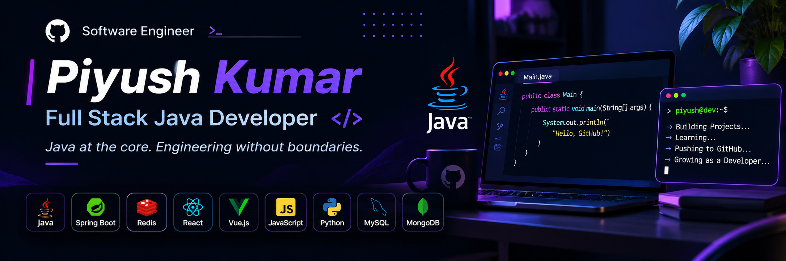

  

 
<!-- ================= PROFILE HEADER ================= -->

# Piyush Kumar

### Java at the core. Engineering without boundaries.

**Full Stack Java Developer | Backend Engineering | AI Integration**

Building scalable applications, exploring intelligent systems, and turning ideas into meaningful software.

---

<!-- ================= ABOUT ME ================= -->

## 👨‍💻 About Me

- 🔭 Currently working on **Redis-powered applications and RAG systems**
- 🌱 Exploring **Spring Boot, System Design, AI Integration and Backend Architecture**
- 👯 Looking to collaborate on **Java, Full Stack and AI-powered applications**
- 🤝 Interested in learning more about **Scalable Systems and Software Architecture**
- 💬 Ask me about **Java, OOP, React, Vue.js and GSAP**
- ⚡ I believe great software starts with strong fundamentals and continuous improvement.

---

<!-- ================= TECH STACK ================= -->

## 🛠️ Technologies & Tools

### Programming Languages

  

### Frontend Development

  

### Backend Development

  

### Database & Tools

  

### Currently Exploring

`Spring Boot` `Redis` `RAG Systems` `System Design` `AI Integration`

---

<!-- ================= GITHUB ANALYTICS ================= -->

## 📊 GitHub Analytics

<table>
<tr>
<td width="50%" align="center">

</td>
<td width="50%" align="center">

</td>
</tr>
</table>

---

## 🔥 Contribution Streak

---

## 🏆 GitHub Achievements

---

<!-- ================= FEATURED PROJECTS ================= -->

## 🚀 Featured Projects

**More projects coming soon!**

Explore all my repositories:

<a href="https://github.com/ARIZE0000000009?tab=repositories">View All Repositories →</a>

---

<!-- ================= CURRENT FOCUS ================= -->

## 🎯 Current Focus

| Area | Focus |
|---|---|
| Java Development | Core Java, OOP, Spring Boot |
| Backend Engineering | REST APIs, System Design |
| Databases | MySQL, MongoDB, Redis |
| Frontend | React, Vue.js, GSAP |
| AI Engineering | RAG Systems, AI Integration |

---

<!-- ================= CONNECT ================= -->

## 🤝 Let's Connect

---

### "Think deeply. Code precisely. Build relentlessly."

**Thanks for visiting my profile!**

⭐ If you find something interesting, feel free to explore my repositories.

